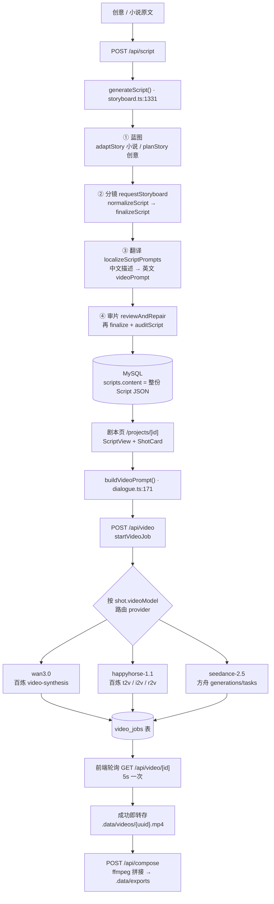
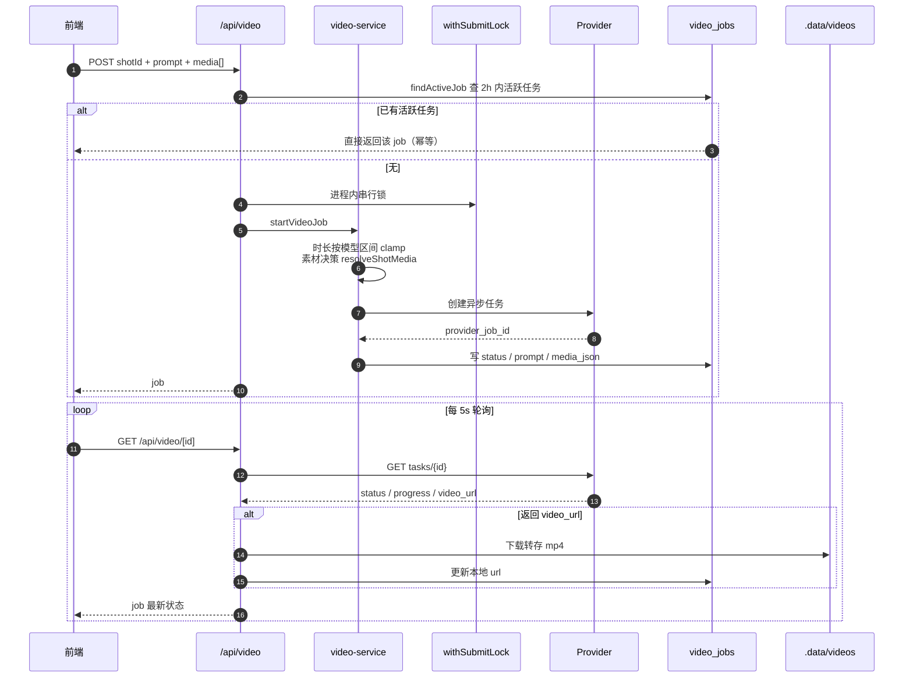
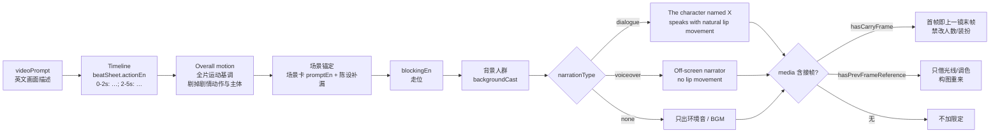
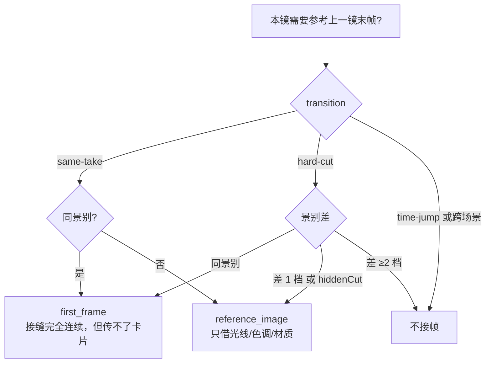
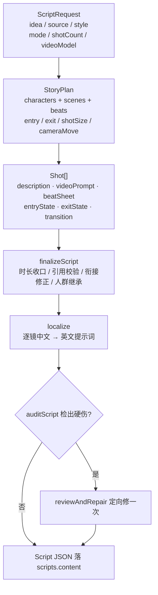

# 生成链路

从「创意 / 小说」到「成片」的完整链路图。分镜生成见 `lib/agents/storyboard.ts:1331 generateScript`，单镜出视频见 `lib/services/video-service.ts`，提示词拼装在 `lib/skills/dialogue.ts:171 buildVideoPrompt`。

## 总链路

## 单镜出视频时序

## 提示词最终拼装顺序

顺序由 `buildVideoPrompt` 固定，旧剧本缺字段时对应片段整段不出现。

## 接帧素材决策

判定见 `lib/skills/shot-media.ts:67 prevFrameUsage`，`VIDEO_REFERENCE_PREV_FRAME` 关掉后 hard-cut 一律不接。

## 分镜四步流水线的数据流

